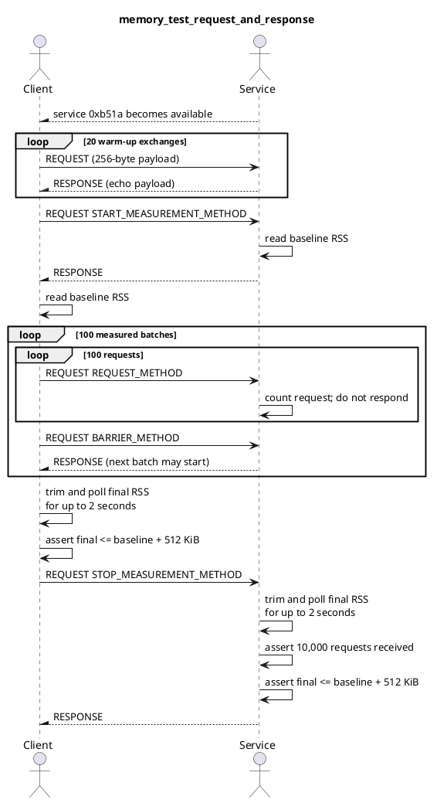
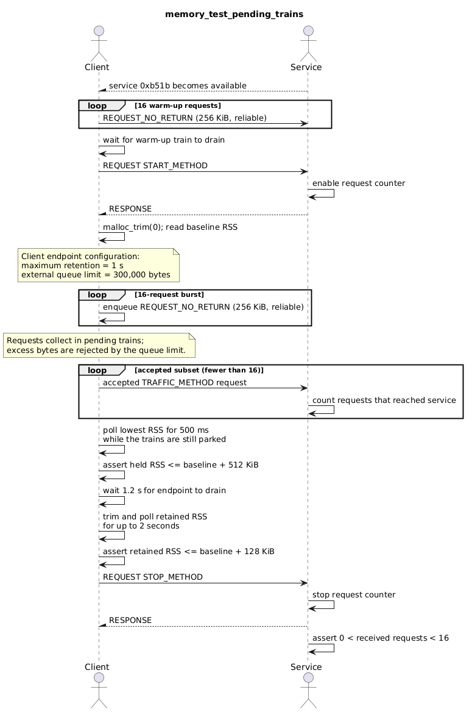
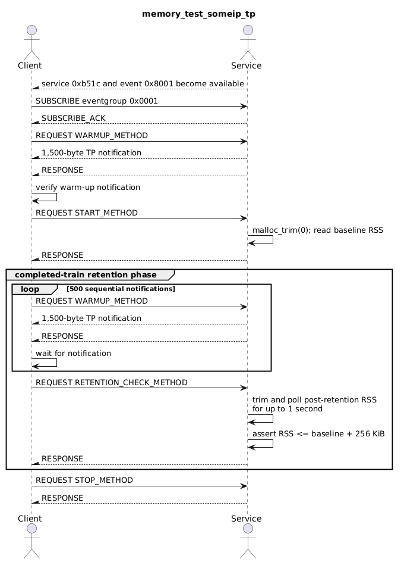

# Memory Tests

The memory test suite verifies that resident memory remains bounded while real
vsomeip applications exchange messages over the network through three focused tests:

- `memory_test_request_and_response`
- `memory_test_pending_trains`
- `memory_test_someip_tp`

Splitting the scenarios makes a failure identify the affected communication path
and allows every test to use a short workload and a path-specific memory limit.

## Shared test design

Every test starts a service on the master and a client on the slave. The
applications communicate over unreliable UDP endpoints, except for the
pending-train scenario, which needs a reliable TCP endpoint for its large
requests.

Memory is measured as resident set size (RSS) in KiB by reading
`/proc/self/statm`. Each scenario first warms up the communication path, records a
baseline, performs its measured workload, and compares a later RSS value with the
baseline. Before each relevant sample, the tests call `malloc_trim(0)` so unused
pages retained by the allocator do not look like live test data. A final sample
may be repeated for a short, bounded settling period. This absorbs transient
scheduler and queue-drain timing under parallel load without increasing the RSS
limits or hiding memory that remains referenced.

These tests are not registered when `VALGRIND_TYPE` is set or when sanitizers are
enabled with `ENABLE_SANITIZERS` or `ENABLE_THREAD_SANITIZER` as Valgrind and
sanitizer runtimes change allocation behavior and maintain additional metadata,
such as shadow memory, quarantined allocations, and per-thread access histories.
Since the resulting RSS growth is workload-dependent and can exceed the tests' small
native limits even when memory is correctly released, increasing those limits to
accommodate instrumentation would hide the regressions these tests are intended
to detect, so their RSS assertions are evaluated only in native builds.

The tests are also not built on QNX. RSS sampling relies on `/proc/self/statm`
and `malloc_trim(0)` is glibc-specific, neither is available in the QNX libc, and
the RSS limits are tuned against the glibc allocator's page-return behavior.

## Request and response

### Purpose

`memory_test_request_and_response` verifies that memory does not grow with the number
of processed requests.

### Test logic

1. The service offers service `0xb51a`, and the client waits for availability.
2. The client completes 20 request/response exchanges with a 256-byte payload to
   warm up both processes.
3. A start request makes the service record its baseline RSS. After receiving the
   response, the client records its own baseline.
4. The client sends 100 batches of 100 measured requests. The service counts these
   requests without replying to each one. A barrier request/response after every
   batch provides application-level flow control without clearing the measured
   request state.
5. After all 10,000 measured requests, the client polls its final RSS for up to two
   seconds. A stop request makes the service do the same and return its last
   response.
6. Both processes verify that final RSS is no more than 512 KiB above their
   respective baselines. The service also verifies that all measured requests were
   received.

## Pending trains

### Purpose

`memory_test_pending_trains` verifies that unsegmented requests waiting in the
client endpoint's batching stage are included in queue-limit accounting and are
released after the endpoint drains.

### Test logic

1. The service offers service `0xb51b`, and the client waits for availability.
2. The client sends 16 256 KiB no-return requests and waits for the batching path
   to warm up and drain.
3. After a start request/response, the client trims unused allocator pages and
   records its baseline RSS.
4. Over reliable transport, the client sends a burst of 16 no-return requests. Its
   endpoint is configured with a one second maximum retention time and a
   300,000-byte external queue limit, which deliberately allows one 256 KiB request
   into a pending train and drops excess traffic.
5. While the trains are still parked, the client polls its RSS for up to 500 ms and
   keeps the lowest sample. The burst first crosses the local
   application-to-router endpoint, which briefly holds every offered byte
   regardless of what the boardnet endpoint accepts, so only the lowest sample
   taken inside the retention window reflects the memory the endpoint keeps. The
   client then waits 1.2 seconds for the endpoint to drain and polls retained RSS
   for up to two seconds.
6. The client verifies that the held RSS stayed within 512 KiB of the baseline,
   which is twice the single request the queue limit lets through and an eighth of
   the 4 MiB the burst offers, and that retained RSS returns to within 128 KiB of
   the baseline. The service verifies that at least one request arrived but fewer
   than the 16 offered requests reached it, proving that the configured queue limit
   was exercised.

## SOME/IP-TP

### Purpose

`memory_test_someip_tp` verifies that completed segmented notification trains are
released.

### Test logic

1. The service offers service `0xb51c` and an unreliable event. The client
   requests the event, subscribes to its eventgroup, and waits for service
   availability.
2. A 1,500-byte notification confirms that SOME/IP-TP delivery is operational.
3. A start request makes the service trim unused allocator pages and record its
   baseline RSS.
4. In the retention phase, the client requests and waits for 500 sequential
   1,500-byte notifications. The service polls RSS for up to one second and
   verifies that completed segmented trains retained no more than 256 KiB.
5. The client sends the stop request and both processes exit.

